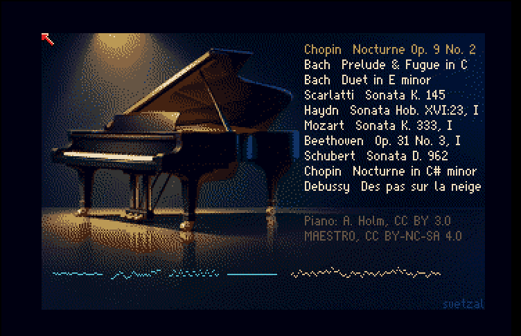
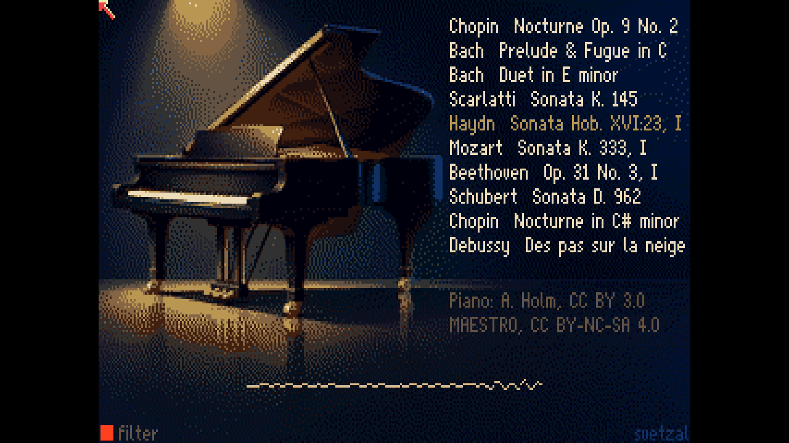

A modern sampled piano is about a gigabyte of recordings. Salamander Grand Piano, Alexander Holm's recording of a Yamaha C5, has sixteen velocity layers for every third key. Google's MAESTRO dataset is MIDI recorded on Yamaha Disklaviers during the International Piano-e-Competition, so every note carries how hard the pianist struck it, and the pedals are there too.

A base Amiga 500 has 512 KB of chip RAM and four 8-bit voices. An Amiga 3000 has a 68030 and up to 16 MB of fast RAM. How much of that piano, and of those pianists, can each one carry?

I built two players to find out, one for each machine, playing the same ten performances from the same sources. The A500 player hands the work to Paula, the Amiga's sound chip. The A3000 player makes the 68030 do the work and uses Paula only as an output.

Here they are, each one unattended run from boot to the end of the tenth piece: [the A500 video](https://youtu.be/yBTHO0fcXG8), [the A3000 video](https://youtu.be/Gj2lQXOR1cc), and [the A3000 video with 16 kHz samples](https://youtu.be/HgrF5hPTfbU).

## What the sources hold

The [Salamander Grand Piano](https://freepats.zenvoid.org/Piano/SalamanderGrandPiano/) edition I used is 44.1 kHz, 16-bit, 1.1 GB unpacked. Holm sampled every minor third from A0 to C8, 30 notes, each at sixteen velocities. Its own mapping file stretches each recording over the keys on either side of it, so no key is more than a semitone from a real recording.

[MAESTRO](https://magenta.tensorflow.org/datasets/maestro) gives each note a key, a time, and a velocity from 1 to 127, along with the sustain, sostenuto and soft pedals as they moved. The performances keep their rubato, chords spread over a few milliseconds, and in the Chopin, a pedal that's down most of the time.

Both players share one conversion of the performances, and it gives up a few things on purpose:

- **Time in milliseconds.** A 60 Hz frame is 16.7 ms, coarse enough to flatten a spread chord. Each player counts real milliseconds instead.
- **The sustain pedal as up or down.** Down at MIDI value 64 or more, the usual threshold. Half-pedalling goes.
- **No sostenuto or soft pedal.** They're counted and left out, and neither player uses them.
- **A compact byte stream.** A note on is two bytes, a note off one, short waits one. The longest score is 19 KB.

So the scores keep nearly everything the pianist did. The hard part is choosing which samples to keep and how to store them, and each machine has a different budget for that.

| In the sources | Amiga 500 | Amiga 3000 |
| --- | --- | --- |
| 16 velocity layers per note | 1 layer; Paula's volume makes the dynamics | 8 layers, softest and loudest always kept |
| 30 sampled notes | all 30 | all 30 in each layer, 240 samples |
| 44.1 kHz, 16-bit | 8-bit, about 11.2 kHz for most keys | 16-bit, 11 kHz to 28 kHz |
| Each note's full decay | 1.4 s to 0.4 s of attack, then a short loop | 2.8 s to 0.8 s of attack, then a short loop |
| Every string that rings | 4 voices, Paula's own | 16 voices, mixed by the 68030 |
| Pitch from the recording | Paula's period, at most 3.1 cents off | Resampled with linear interpolation |
| Memory | 329 KB of chip RAM | 11.0 MB of fast RAM |

I ran this the way I ran [coco-llm](https://github.com/svetzal/coco-llm). Agents wrote the code, built the disks, booted them in the Amiberry emulator and read back what happened. I listened, and decided what to change. Everything is in [svetzal/amiga-llm](https://github.com/svetzal/amiga-llm), in two experiment records: [EXP-004, the A500 piano](https://github.com/svetzal/amiga-llm/blob/main/experiments/EXP-004-expressive-piano.md), and [EXP-006, the A3500 piano](https://github.com/svetzal/amiga-llm/blob/main/experiments/EXP-006-the-a3500-piano.md).



## The Amiga 500: let Paula be the instrument

Paula has four 8-bit voices, each with a volume from 0 to 64, and it plays samples straight out of chip RAM without any help from the CPU. Each voice reads its sample at a period, a count of clock ticks per sample, and the period sets the pitch. The 68000 could mix voices in software, but eight would take about a third of its time. Paula does the pitch, Paula does the volume, and the 68000 decides what to start, when, and how loud. That kept the 68000 at about 17% of its time.

That leaves memory as the tighter budget. The machine has 512 KB of chip RAM, shared with the program, the screen and the scores. A gigabyte had to become about 329 KB.

**One velocity layer.** Every note plays the same recording for the different velocities, the Salamander's layer for velocities 57 to 64. A piano struck softly sounds darker as well as quieter, and one layer gives that up. Loudness alone carries the dynamics, so the curve from velocity to Paula volume decides how expressive the result sounds. A square law pushed quiet notes down to volumes 1 to 3, where each step of Paula's volume is 3 to 6 dB. A power of 1.5 keeps them off that floor.

**Every sample at full scale.** An 8-bit sample of a quiet recording plays from its bottom few bits. So each sample is normalised to the full 8-bit range from the original 16-bit samples. Its real level goes into a table, and the player multiplies that level into Paula's volume. Paula's volume then scales the quantisation noise down with the note, keeping its fidelity in pianissimo passages.

**A rate for each root that Paula can play exactly.** Paula's pitch is a whole number of clock ticks, so a sample stored at an arbitrary rate leaves its key slightly out of tune. The build searched, root by root, for the rate where the root is exact and its neighbours round closest. No key is more than 3.1 cents off. Most of the keyboard sits near 11.2 kHz, and the A500's fixed output filter, at about 4.4 kHz, hides most of what that rate loses.

**Long attacks, short loops.** Each sample keeps 1.4 s of recording in the bass, down to 0.4 s in the treble, then loops about 100 ms with a 10 ms crossfade at the seam. The build costed the alternatives. A 14 kHz minimum rate went 12 KB over budget. Keeping only every sixth semitone halved the memory but left keys up to three semitones from their recording. The memory went to attack length instead.

### Where four voices ran out

I listened to a number of the model's renders, and notes cutting off early came up again and again. When I'd finished listening for aliasing, I raised it: "I am noticing some notes clipped early, it's a little jarring, but in general it sounds quite nice."

The model logs every note the player stops early, and the reason, so we could count the causes. In the Op. 9 No. 2 nocturne, the pianist's fingers hold at most six keys down, and usually four or fewer. The sustain pedal is down 93% of the time, and every note struck while it's down keeps sounding until the pedal comes up. For 5% of the piece, 31 or more strings are ringing at once, and at the peak, 43.

The A500 has four voices. To start a new note when all four are sounding, the player has to stop one, which I called stealing a voice. The first rule stole the quietest. A melody note held under the finger fades as it rings, so it was often the quietest voice, and louder accompaniment notes stole it 87.5 times a minute.

Two changes went in:

1. Steal a note whose key is up before one under a finger. Melody steals in the nocturne fell from 87.5 a minute to 7.3.
2. Fade a stolen note over 3 ms (volume 3/4, 2/4, 1/4, one step a millisecond) instead of cutting it. The new note starts 5 ms late, and the click is 12 dB smaller.

The total number of cuts didn't fall. They moved to the pedalled accompaniment and got softer. Eight software voices wouldn't have fixed it either, because the nocturne still rings past eight. All of this was measured in the model, before it was coded for the Amiga.

<aside class="hardware-detail" aria-labelledby="a500-timing-title">

<h3 id="a500-timing-title">Inside the 68000: a millisecond clock, not the screen's</h3>

The player takes CIA-B timer A and runs it with a latch of 715, an interrupt every 716 E-clock ticks, 1.000127 ms. Each interrupt does one millisecond of the model: fades, then the score's events due, then the 60 Hz decay tick if one falls on it. Even the decay ticks are counted in milliseconds rather than taken from the vertical blank, because Amiberry's NTSC frame runs at 59.83 Hz and would drift against the model.

More than half the player's cost is being called a thousand times a second: 9.4% of the CPU just in dispatch, on interrupts that mostly have nothing to do. A one-shot timer set to the next millisecond with work would cut that to about 1%. At 17% overall, it wasn't worth the change. [EXP-004 has the figures](https://github.com/svetzal/amiga-llm/blob/main/experiments/EXP-004-expressive-piano.md#cpu-time).

</aside>



## The Amiga 3000: the 68030 becomes the instrument

I've got an Amiga 3000 and an Amiga 3500 on my bench. The Amiga 3500 is a prototype I rescued from Commodore Canada as it was to be crushed during liquidation (no commercial value). I wanted the A3000 target for both of those machines, and it's not uncommon now to find Amiga 3000 computers with their motherboard ram maxed ou at 16 MB. The shape also fits other A3000 and A4000 style machines.

Paula can't play from fast RAM, so the samples can't go to Paula directly any more. The 68030 has to read them, resample them and mix them itself. That costs CPU, but I hoped it would remove both of the A500's limits at once: the samples can be as big as fast RAM allows, and the voice count is whatever the 68030 can mix. The target was sixteen voices in at most half the CPU.

The 68030 mixes sixteen voices into 512-sample blocks at about 28 kHz, and Paula plays the result. Paula still has only 8-bit channels, so each of the two stereo outputs are split across two of Paula's channels: the high byte on one channel at volume 64, the next six bits on another at volume 1. Paula adds them, giving 14-bit stereo.

The budget for the samples settled in at 11MB after I weighed all the factors.

- **Eight velocity layers of sixteen, kept at 16 bits.** The kept layers' centre velocities are spread evenly, and the softest and loudest recordings are always kept, so the tone darkens and brightens across the whole range.
- **Attacks twice as long**, 2.8 s in the bass to 0.8 s in the treble.
- **No jump between layers.** Used the way Salamander's mapping file describes them, eight layers would jump in loudness wherever one gives way to the next. Instead each root's recorded level is pinned at each layer's centre velocity and interpolated in decibels between centres. Loudness follows velocity smoothly, and only the tone changes where the layer changes.
- **Rates from 11 kHz to 28 kHz.** Most of the keyboard is stored at 11,025 Hz, the treble higher. A 16 kHz floor would have needed about 14.8 MB, more than the 12 MB set aside for samples. That 12 MB turned out to be a guess, so I measured what the player needs while it runs and kept a 1 MB margin. That left room for 15.4 MB of samples, so I built a second A3000 edition with a 16 kHz floor. It uses about 40% of the CPU at its busiest, up from 38%. Here's [the 16 kHz video](https://youtu.be/HgrF5hPTfbU).

### The overtone, and the headroom

To play a key, the mixer steps through that key's sample at its own speed, and the speed is rarely a whole number of samples per step. So the 68030 keeps its place in the sample as a number with a fraction, say position 1,000.4. The first mixer ignored the fraction: it played sample 1,000 until the position reached 1,001, then jumped. That turns a smooth wave into a staircase, and the corners of the staircase add tones that were never in the recording. That's the metallic overtone I heard in the first renders. Measured against an ideal resample, those added tones were 7 to 20 dB quieter than the music, loudest in the treble.

Using linear interpolation fixed most of it. At position 1,000.4, the mixer takes 60% of sample 1,000 and 40% of sample 1,001, so the wave changes smoothly between stored samples instead of in steps. That keeps the added tones at least 21.6 dB below the music. I compared A/B clips and picked it. It costs the inner loop 18 instructions per voice per sample instead of 7.

The headroom problem showed up in the measurements, not by ear. The first mixer added its voices into a 16-bit total, with the volume set low enough that sixteen neighbouring keys struck as hard as possible couldn't overflow it. No piece comes close to that, so the actual pieces came out 16 to 26 dB below full scale, using 10 to 11.5 of the 14 bits Paula can play. The mixer now adds into a 32-bit total and scales it down once per output sample, with the volume set so the loudest piece, Bach's Prelude in C, peaks 1 dB below full scale. Anything louder is clamped to full scale instead of wrapping around, and the build counts it. No piece clamps.

### What sixteen voices changed

Across all ten pieces, notes cut off while still sounding fell from 56.2 a minute to 3.1. About 90% of the rest are restrikes, a key struck again while its last note still rings. A real piano lets that string keep sounding as long as the damper doesn't hit it. This player fades it out.

<aside class="hardware-detail" aria-labelledby="a3500-loop-title">

<h3 id="a3500-loop-title">Inside the 68030: the inner loop</h3>

Every voice, every output sample, both sides:

```text
move.l  (a0,d0.l*2),d4   ; this sample and the next
move.l  d4,d6
swap    d6               ; s0
sub.w   d6,d4            ; s1 - s0
move.w  d2,d5
lsr.w   #1,d5            ; the phase's fraction, as 15 bits
muls.w  d5,d4
add.l   d4,d4
swap    d4
add.w   d6,d4            ; the interpolated value
move.w  d4,d6
muls.w  d7,d4            ; times the left gain
add.l   d4,(a2)+
swap    d7
muls.w  d7,d6            ; times the right gain
add.l   d6,(a3)+
add.w   d1,d2            ; advance the phase
addx.l  d3,d0
```

One `MOVE.L` fetches a sample and its neighbour together. Each sample is followed by 1,024 samples of its own loop, and no key steps faster than two samples per output sample, so a 512-sample block can never read past the padding. The loop never checks a bound. On the emulator the densest piece takes 39.5% of the CPU on average and 47.5% in its worst block with the screen drawing, against the 50% limit. At 16 MHz, the slower A3000, that worst block would come close to three quarters. The [mixing benchmark is EXP-005](https://github.com/svetzal/amiga-llm/blob/main/experiments/EXP-005-software-mixing-on-the-a3500.md).

</aside>

## Prototype first, in Python

Before either Amiga player existed, each one was written as a Python program on the Mac. The Python version does the same arithmetic the Amiga will do, with the same whole numbers and the same limits, and writes the result to a WAV file I can listen to.

That made experiments fast and cheap. Building all 240 of the A3000's samples and rendering all ten pieces takes about 16 seconds. So ideas got tried in Python first: a different rule for stealing voices, interpolation or none, a different sample rate. I listened to the results, and the Python version counted what changed, such as every note cut short and why, or how far the resampling was from ideal. The 16 kHz clips I'm comparing now came from it too.

Only when a design sounded right did it become 68000 or 68030 assembly. Each Amiga player writes a log of everything it does, and that log has to match the Python version's byte for byte, so what I heard in the WAVs is what the Amiga plays. Both players matched on the first run. On the A3000, the Python version also supplies the numbers the assembly is built with, so the two can't disagree.

In effect, the reference model was the quality control for the Amiga implementations, ensuring that our bets paid off when it ran on real hardware.

## How the ten pieces held up

I'm not a sound engineer, and I'm not an expert on these compositions. A lot of the fun of a project like this is hearing from people who are, because their ears catch what mine miss, and each catch makes the next version better. A friend who knows the repertoire caught one right away. MAESTRO's catalogue lists a 2009 recital as four tracks labelled "D. 960" to "D. 963", and they're really the four movements of Schubert's Sonata in B-flat, D. 960. Ours is the third movement. All the disks and video descriptions now say so.

The ten pieces weren't picked at random. MAESTRO has 501 performances of the right length, and I had the model count how many notes the four-voice player would cut in each. Apart from the target, Chopin's Nocturne Op. 9 No. 2, and a control, Bach's Prelude and Fugue in C, each piece is the performance by its composer that the A500 cut least. So every piece is its composer's best case on the A500.

The last two columns count notes cut short while still audible (at 4/64 of full volume or more), per minute of music. "Pedal" is the share of the piece with the sustain pedal down. "Ringing" is how many strings sound at once in the busier passages (the 95th percentile, by time).

| Piece | Pedal | Ringing | A500 | A3000 |
| --- | ---: | ---: | ---: | ---: |
| Chopin, Nocturne Op. 9 No. 2 | 93% | 31 | 281.9 | 97.1 |
| Bach, Prelude and Fugue in C, BWV 846 | 10% | 5 | 37.3 | 0.3 |
| Bach, Duet in E minor, BWV 802 | 1% | 2 | 0 | 0 |
| Scarlatti, Sonata K. 145 | 18% | 3 | 16.3 | 8.4 |
| Haydn, Sonata Hob. XVI:23, I | 5% | 3 | 11.8 | 6.3 |
| Mozart, Sonata K. 333, I | 7% | 4 | 14.5 | 3.8 |
| Beethoven, Sonata Op. 31 No. 3, I | 26% | 7 | 78.0 | 32.7 |
| Schubert, Sonata D. 960, III | 4% | 4 | 31.3 | 3.9 |
| Chopin, Nocturne in C# minor | 82% | 14 | 136.3 | 43.3 |
| Debussy, Des pas sur la neige | 80% | 9 | 26.3 | 3.1 |

Where few strings ring at once, both machines play nearly everything. Bach's two-part Duet loses nothing on either. Scarlatti, Haydn, Mozart and Schubert rarely have more than four strings sounding, so the A500 copes most of the time, and the A3000 cuts only a few notes a minute, almost all of them restrikes.

The Prelude and Fugue in C shows what sixteen voices buy. Its pedal is rarely down, but its chords and overlapping lines often need five strings or more, one past the A500's four. The A500 cuts 37 audible notes a minute and the A3000 almost none. The Debussy has the pedal down most of the time, but it's slow and sparse, so sixteen voices hold it almost completely.

The Beethoven and the two Chopin nocturnes are where both players still fall short. The nocturnes keep the pedal down 82 to 93% of the time, with 14 to 31 strings ringing in their busier passages. The A500 can't come close, and the A3000 still cuts 43 and 97 audible notes a minute. Most of the A3000's cuts are restrikes: the pianist strikes a key again while it still rings, and the player fades the old note where a piano would let the string keep sounding.

My friend also asked whether the attack makes fast runs stumble in places. I think it does, but that's an inference so far. Each sample starts where its recording first rises past 1% of its peak, and the rise after that differs from one recording to the next. Between C4 and C6, the A500's samples take 2.5 to 11.2 ms to reach half their attack's peak, so a fast run that crosses from one recording to the next shifts its notes by a few milliseconds the pianist didn't play. The A500's 5 ms delay on a stolen voice adds to it in the Chopin. The test is to align every sample so its attack peaks at the same moment, render a run both ways, and listen.

## Where the fidelity goes

On the A500, the voice count sets the limit. Paula plays every note in tune, at a volume that follows the pianist's touch, from samples sized to fit. It can't hold a pedalled Chopin texture in four voices.

On the A3000, the voice count mostly stops mattering. What's left is in the samples (how their attacks were trimmed and where their loops sit) and in the restrikes a real piano would let ring. The trimming and looping happen on the Mac, so both machines get the next improvement in sample preparation at no cost at run time.

## Play it yourself

The disk images are on the project's GitHub release. Each zip holds the image and a Credits file.

| Download | For | Size |
| --- | --- | --- |
| [amiga500-piano.zip](https://github.com/svetzal/amiga-llm/releases/download/pianos-2026-11-10/amiga500-piano.zip) | Amiga 500, floppy (ADF) | 0.4 MB |
| [amiga3000-piano-11khz.zip](https://github.com/svetzal/amiga-llm/releases/download/pianos-2026-11-10/amiga3000-piano-11khz.zip) | Amiga 3000, hard disk (HDF), 11 kHz samples | 9.9 MB |
| [amiga3000-piano-16khz.zip](https://github.com/svetzal/amiga-llm/releases/download/pianos-2026-11-10/amiga3000-piano-16khz.zip) | Amiga 3000, hard disk (HDF), 16 kHz samples | 13.4 MB |

Each one boots straight into the piano and plays all ten pieces by itself. The audio filter starts off, and F turns it on and off. You'll need your own Kickstart ROMs; the images don't include any.

These are the settings I recorded with, in Amiberry 8.5.0.

For the Amiga 500 floppy:

1. On the Quickstart panel, pick the A500 model and NTSC.
2. On ROM, choose Kickstart 1.2.
3. On RAM, set 512 KB of chip RAM and 512 KB of slow RAM.
4. On Floppy drives, put `amiga500-piano.adf` in DF0: and start.

For either Amiga 3000 hard disk:

1. On the Quickstart panel, pick the A3000 model and NTSC.
2. On ROM, choose the A3000's Kickstart 2.04.
3. On CPU and FPU, set a 68030, with cycle exact on.
4. On RAM, set 2 MB of chip RAM and 16 MB of fast RAM. I used the A3000's motherboard fast RAM. The 16 kHz image needs nearly all of it.
5. On Hard drives, add the HDF as a hardfile on the A3000 SCSI controller, then start.

On real hardware, the ADF goes on a floppy or a Gotek. I built the HDF for the BlueSCSI in my own machine, and it should work on other SCSI emulators that take HDF images. I've only tested these in Amiberry so far, so I'd love to hear how they do on a real machine.
